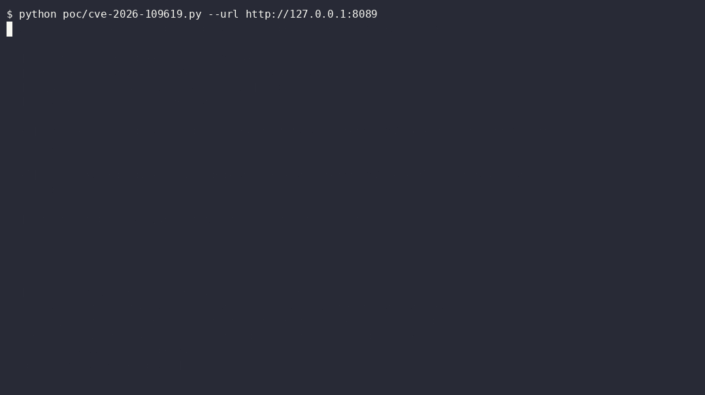
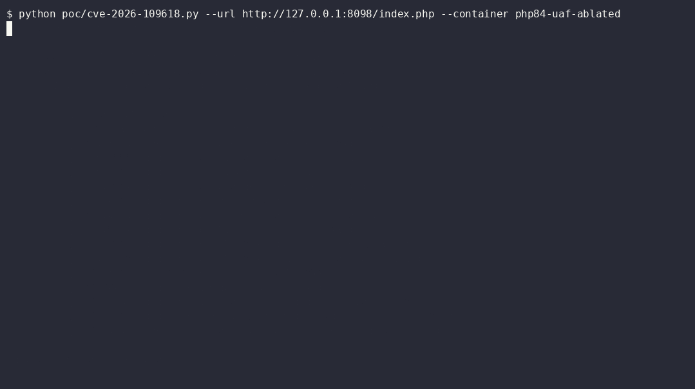
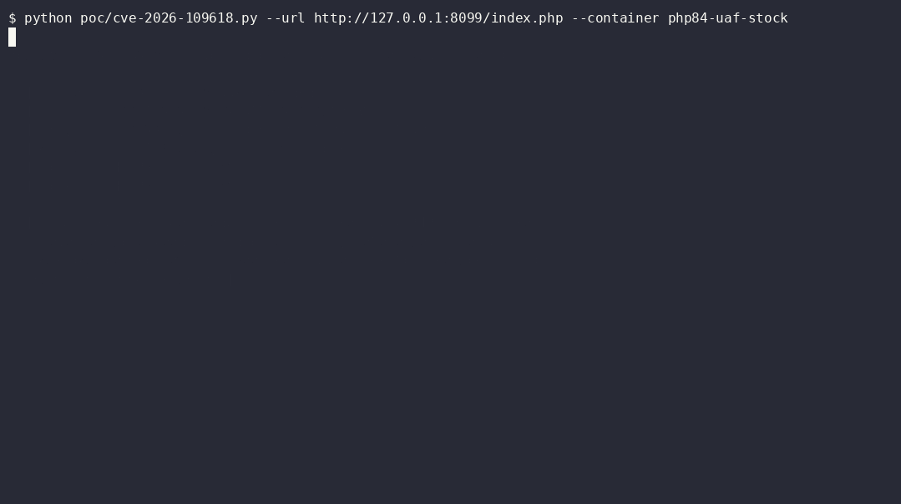

# PHP2Shell Lab  -  CVE-2026-109618 / CVE-2026-109619

Reproducible, **local-only** lab for the two "PHP2Shell" PHP-core RCE claims:
one Docker target, two stdlib Python PoCs, a valgrind-instrumented
environment that shows exactly which single line of `ext/session/session.c`
the use-after-free story depends on, and working mitigations that are
verified live in the same lab.

> **Authorized use only.** Everything here runs against containers on your
> own machine. Do not point the PoCs at systems you do not own or have
> written permission to test. Do not expose the lab containers.

## Verification status (the honest version)

Both CVEs got CVSS v4.0 9.2 headlines; PHP shipped an emergency security
release on **2026-10-21 14:00 UTC** (claimed fixed: 8.5.12 / 8.4.27 / 8.3.36 /
8.2.35). Public attribution is messy: MITRE returned `CVE_RECORD_DNE` when
this lab was built, and upstream analysis ([jaiswalakshansh] found **0 of 29
public PoC repos** triggering a memory error on stock PHP. This repo keeps the
claims and the proofs strictly separate:

| Claim / mechanism | Status here | Proof |
|---|---|---|
| Upload-progress session poisoning -> `include()` -> RCE (the deterministic "php2shell" demo chain) | **Reproduced** on stock `php:8.4.26-apache` | [`writeups/CVE-2026-109619.md`](writeups/CVE-2026-109619.md) + live PoC |
| `php_session_rfc1867_update()` heap UAF (`post_bytes_processed` dangling zval*) | **Reproduced on an ablated build only**: stock 8.4.4 stays clean because `Z_TRY_ADDREF(progress->data)` keeps the array alive; remove that one line and you get the writeup's use-after-free, reported by valgrind memcheck (on the Docker Desktop WSL2 VM ASAN self-crashes at init, so this lab uses memcheck; ASAN works on regular Linux/macOS) | [`writeups/CVE-2026-109618.md`](writeups/CVE-2026-109618.md) |
| Full memory-corruption weaponization (`eness` `poc_109618.py`) | **Not reproduced**: requires an out-of-band `zval_ptr_dtor` leak and offsets hardcoded for one Ubuntu 8.5.4 build | analyzed in the 109618 writeup |
| CVE id <-> mechanism binding | **Unconfirmed** for both ids (no vendor advisory at lab build time) | stated everywhere |

## Demo

CVE-2026-109619 chain, recorded live on 2026-10-21. Same code, same PoC,
one ini flag apart:

CVE-2026-109619 chain (vulnerable vs one ini flag away), and the
CVE-2026-109618 UAF trigger (ablated build vs stock build):

| Vulnerable lab (`:8088`) | Mitigated (`:8089`) |
|---|---|
|  |  |

| Ablated PHP 8.4.4 - use-after-free | Stock PHP 8.4.4 - clean |
|---|---|
|  |  |

## Quickstart (Windows or Linux, Docker Desktop / Engine)

```bash
git clone https://github.com/34zY/php2shell-lab
cd php2shell-lab

# 1) the RCE chain target: PixelVault lab app on :8088
docker compose up -d --build lab
python poc/cve-2026-109619.py --url http://127.0.0.1:8088
#    -> [+] PASS: remote code execution confirmed as the web user  (exit 0)

# 2) the UAF proof environment (compiles PHP 8.4.4 twice, run under valgrind, ~10 min)
docker compose --profile uaf up -d --build
python poc/cve-2026-109618.py --url http://127.0.0.1:8098/index.php --container php84-uaf-ablated
#    -> [+] PASS: use-after-free in the server sanitizer log        (exit 0)
python poc/cve-2026-109618.py --url http://127.0.0.1:8099/index.php --container php84-uaf-stock
#    -> [-] CLEAN: the UAF window does not exist on stock PHP       (exit 1)

# 3) mitigation: same app with the vulnerable surface switched off
docker compose --profile fixed up -d lab-fixed          # :8089
python poc/cve-2026-109619.py --url http://127.0.0.1:8089
#    -> [-] no code execution                                      (exit 1)

docker compose down
```

Linux: use `python3`. Every port is overridable (`LAB_PORT`, `UAF_STOCK_PORT`,
`UAF_ABLATED_PORT`, `LAB_FIXED_PORT` env vars for compose, `--url` for the
PoCs). A `make` wrapper exists (`make up poc109619 uaf poc109618-ablated
poc109618-stock verify down`), but the commands above are the first-class path.

## What's in here

```
docker-compose.yml     lab (:8088 vuln) / lab-fixed (:8089 mitigated) / uaf valgrind builds
lab/                   PixelVault PHP app: intentionally vulnerable include sink + permissive session ini
poc/
  cve-2026-109619.py   session.upload_progress poisoning -> include -> RCE (stdlib, --url/--cmd/-v)
  cve-2026-109618.py   upload-progress UAF trigger + verdict read from `docker logs` (stdlib)
uaf/                   PHP 8.4.4 built twice under valgrind memcheck: php-stock and php-ablated (1 line removed)
mitigations/
  quick-fix.sh         emergency mitigation (apply/check/dry-run/revert/restart), tested live
  uploads-off.ini      the one directive that kills both surfaces
  apache/ lighttpd/ frankenphp/ cloudflare.md   per-server WAF rules
writeups/              full PoC reports with real transcripts and evidence/
evidence/              actual outputs produced by local runs on 2026-10-21
refs/ (gitignored)     upstream clones used to rebuild this lab
```

## Mitigation summary

Both claimed attack surfaces sit on `session.upload_progress`. Until patched
PHP is deployed:

```ini
session.upload_progress.enabled = Off
```

- `mitigations/quick-fix.sh` applies it everywhere (config **scan dirs** +
  FPM pool `php_admin_flag`; scan dirs load after php.ini, so a stray
  `On` cannot hide), verified live: apply -> PoC blocked, revert -> PoC works.
- WAF signatures per server in `mitigations/` (block requests carrying a
  multipart part named `PHP_SESSION_UPLOAD_PROGRESS`; do **not** block
  `PHPSESSID`, it breaks sessions and does not match the primitive).
- Real fix: PHP >= 8.5.12 / 8.4.27 / 8.3.36 / 8.2.35 (2026-10-21 release).

## Scope discovery (authorized red-team engagements only)

The PHP attack surface behind these claims is every default-config web
stack. When scoping an **authorized** engagement, asset search engines index
the product names; FOFA/ZoomEye/Censys-style queries combine them with your
mandated IP ranges. Inventory your own estates the same way before the patch
window closes: MediaWiki, WordPress, phpBB, Magento, Laravel, Drupal,
Symfony, WHM/cPanel PHP endpoints are the usual suspects. Never probe hosts
outside written scope; a search query is scope discovery, not authorization.

## Credits

Derived from and reworked against:
- [jaiswalakshansh/Reversing-Vulnerabilities](https://github.com/jaiswalakshansh/Reversing-Vulnerabilities)
  - PixelVault lab, PoC skeletons, ablation methodology (ASAN upstream; valgrind here), the 0/29 stock-UAF audit
- [eness/php2shell-CVE-2026-109618-CVE-2026-109619-PoC](https://github.com/eness/php2shell-CVE-2026-109618-CVE-2026-109619-PoC)
  - weaponization analysis, patch diff (`uaf/session-upload-progress-counters.patch`), server mitigations

Improvements here: unified single-compose lab, configurable ports/endpoints,
verdict-based exit codes + self-reading sanitizer log (`--container`), complete
working `quick-fix.sh` (upstream one shipped truncated), patched-vs-clean
evidence produced locally, honest per-claim status matrix.

Advisory coverage: [watchTowr FAQ](https://watchtowr.com/intelligence/php-cve-2026-109618-faq/),
[cyberdaily](https://www.cyberdaily.au/security/14328-alert-php-preparing-to-address-pair-of-critical-rce-vulnerabilities),
[RunZero](https://www.runzero.com/blog/php/),
[ma.ttias.be early mitigation](https://ma.ttias.be/php-cve-2026-109618-early-mitigation/),
[Phoenix Security](https://phoenix.security/php-core-rce-cve-2026-109618-109619-critical-remote-code-execution/).
